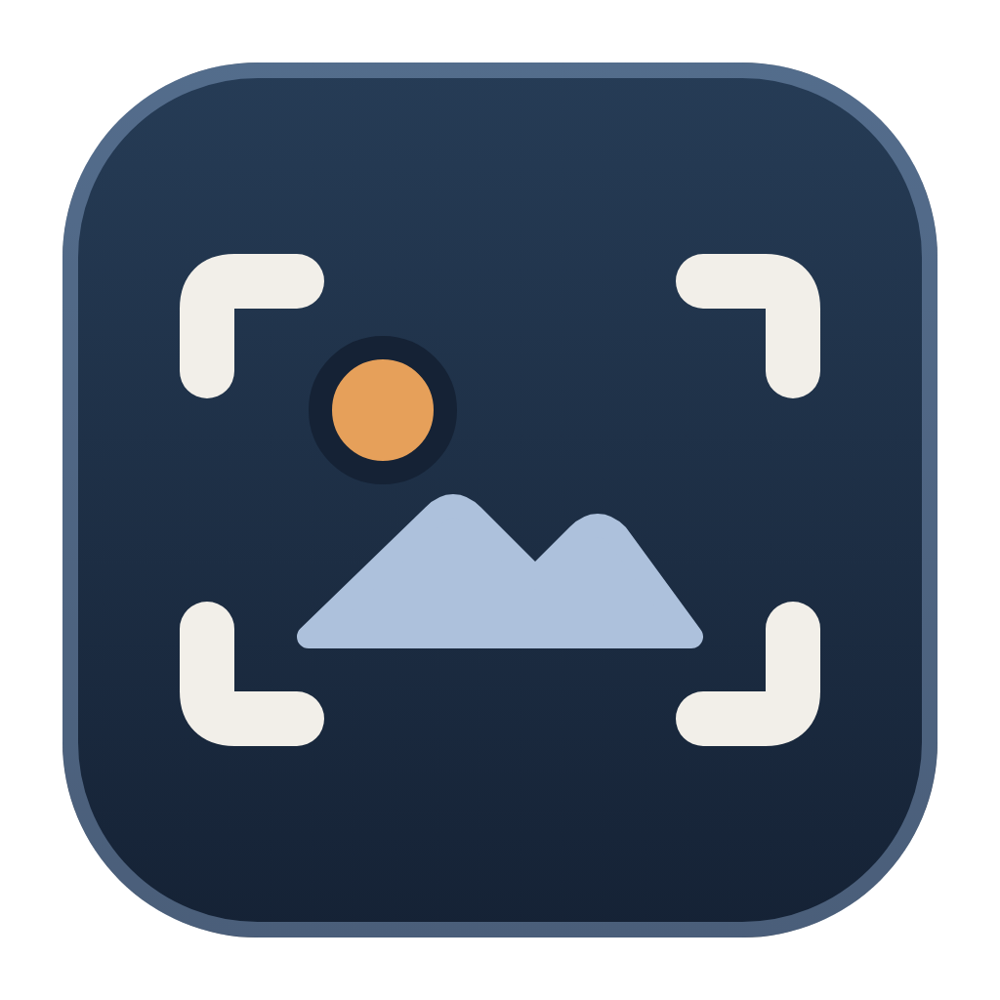

# SnipScreen

<p align="center">
  
</p>

<p align="center">
  A lightweight screenshot and screen-recording tool for Windows, written in Rust,
  with markup, auto-save, and MP4 recording with system and microphone sound.
</p>

<p align="center">
  <a href="https://github.com/rteoo/snipscreen/releases/tag/v0.1.0"></a>
  <a href="LICENSE"></a>
</p>

Press Alt+Shift+S, pick an area, and the snip is on the clipboard and in
`Pictures\Screenshots` before you let go. Mark it up with pen, highlighter,
eraser, and crop, then copy or save it again. Switch to video to record an area
of the screen to MP4, with the computer's sound, your microphone, or both.

SnipScreen follows the Windows Snipping Tool's workflow in a single portable
executable. It is a sibling of [SnipType](https://github.com/rteoo/sniptype) and
[SnipVoice](https://github.com/rteoo/snipvoice), with no shared data or settings.

## Highlights

- Rectangle, window, full-screen, and freeform snips.
- Delay timer (3, 5, or 10 seconds) with a visible countdown that Esc cancels.
- Pen (6 colours), highlighter (4 colours), eraser, crop, and 50-step undo/redo.
- What you see is what you save: the screen and the saved PNG use the same rasteriser.
- Zoom with Ctrl+wheel (anchored on the cursor) or Ctrl+Plus, Ctrl+Minus, and Ctrl+0.
- Automatic copy and auto-save, each with a toast that reports what really happened.
- Screen recording to MP4 (H.264 + AAC, 30 fps) with system sound and a chosen microphone.
- Recordings survive UAC prompts, the lock screen, full-screen apps, and resolution changes.
- A recording that stops early keeps everything captured up to that point.
- Portrait (rotated) monitors record upright.
- No installer, no administrator rights, no telemetry, and no network access.

## Quick start

Download `snipscreen-v0.1.0-windows-x64.zip` from the
[stable v0.1.0 release](https://github.com/rteoo/snipscreen/releases/tag/v0.1.0),
extract it, and run `snipscreen.exe`. To build from source with Rust and the
MSVC build tools (which include the Windows SDK) installed:

```powershell
git clone https://github.com/rteoo/snipscreen.git
cd snipscreen\app
cargo build --release
.\target\release\snipscreen.exe
```

Use `cargo run` for a development build.

### Releases

The current stable release is
[`v0.1.0`](https://github.com/rteoo/snipscreen/releases/tag/v0.1.0):

| Platform | Package |
| --- | --- |
| Windows 10 2004+ x64 (Windows 11 recommended) | Portable ZIP with `snipscreen.exe` |

The executable is not publisher-signed, so Windows SmartScreen may show
**More info → Run anyway** on first launch. SnipScreen has no installer: keep the
executable anywhere and delete it to remove the app.

## First use

1. Start SnipScreen. It opens straight into area picking; press Esc to get the main window.
2. Choose the photo or video mode, a shape (rectangle, window, full screen, freeform), and an optional delay.
3. Click **New**, press Ctrl+N, or press Alt+Shift+S from any app.
4. Drag over an area, or click a window in window mode.
5. The snip opens in the editor, already copied and saved to `Pictures\Screenshots`.
6. Mark it up, then press Ctrl+C to copy it again or Ctrl+S to save a copy elsewhere.

Auto-copy and auto-save can be turned off from the **…** menu. Settings last for
the session; each launch starts from the defaults.

## Shortcuts

| Keys | Action |
| --- | --- |
| Alt+Shift+S | New snip, from anywhere in Windows |
| Ctrl+N | New snip |
| Ctrl+C | Copy the snip with markup |
| Ctrl+S | Save as PNG, or save the recording as MP4 |
| Ctrl+Z | Undo |
| Ctrl+Y or Ctrl+Shift+Z | Redo |
| Ctrl+wheel | Zoom around the cursor |
| Ctrl+Plus / Ctrl+Minus | Zoom in or out |
| Ctrl+0 | Fit the snip to the window |
| Enter | Apply the crop |
| Esc | Close a menu, or cancel the countdown, crop, picking, or recording bar |

Alt+Shift+S is used because Win+Shift+S and Print Screen belong to the system
Snipping Tool. If another app already holds it, the **New** tooltip says so.

## Screen recording

Switch to video mode, pick an area, and press **Start** on the recording bar.
A dashed outline marks exactly what is being recorded and stays out of the video.

| Capability | Behavior |
| --- | --- |
| Area | Rectangle, window, or full screen on one monitor; the outline shows the area actually recorded |
| Format | MP4, H.264 video at 30 fps with AAC sound, up to 4096×2304 |
| Sound | The computer's sound (on by default) and a chosen microphone, each placed on the recording clock |
| Interruptions | Through UAC, the lock screen, full-screen apps, and resolution changes, the last image repeats until the screen is readable again |
| Devices | A microphone that is slow to start or unplugged leaves silence instead of stopping the recording; an unplugged one shows a "!" note on the bar |
| Errors | A recording that stops early is finalized and kept, and the toast says why |
| Files | `Videos\Screen Recordings\Screen Recording <timestamp>.mp4`, never overwriting an existing file |

## Data safety and privacy

SnipScreen writes only the files you create:

- Snips auto-save to `Pictures\Screenshots\Snip <timestamp>.png`.
- Recordings go to `Videos\Screen Recordings\Screen Recording <timestamp>.mp4`.
- Two files from the same second get ` (2)`, ` (3)`, and so on instead of overwriting each other.

It keeps no settings file, history, or logs, and it makes no network requests.
The window hides before each snip, and the recording bar and outline exclude
themselves from capture, so none of them appear in your snips or videos.

## Platform status and limitations

SnipScreen is Windows-only: it uses Win32, DXGI Desktop Duplication, WASAPI, and
Media Foundation directly.

- **One monitor per recording:** an area that spans monitors is trimmed to the monitor under its centre, with a note on the recording bar.
- **Large displays:** frames are trimmed to 4096×2304 (H.264 level 5.2) rather than scaled, so a full-screen 5K or 6K recording loses its edges.
- **Display changes:** after a mode change mid-recording, the video keeps its original size and position.
- **GPU resets:** a driver update or GPU reset during a recording ends it; the video up to that point is kept.
- **Physical verification:** rotated monitors, Bluetooth microphones, and 5K+ displays are covered by unit and device tests on this machine, not by recordings on that hardware.

## Develop and build

The Cargo crate lives in [`app/`](app). Run from `app/`:

```powershell
cargo test                       # unit tests; no screen or sound device needed
cargo test -- --include-ignored  # adds device tests: sound, desktop capture, real-time encoding
cargo clippy --all-targets
cargo run -- --screenshot out.png
```

`--screenshot` renders the UI headlessly, writes a PNG, and exits, which is how
UI changes are checked without driving the desktop.

| Path | What it is |
| --- | --- |
| `app/src/main.rs` | UI, state machine, picker, recording bar, CLI |
| `app/src/markup.rs` | Snip document: strokes, crop, undo, and the ink rasteriser |
| `app/src/recorder.rs` | MP4 recording through DXGI Desktop Duplication and Media Foundation |
| `app/src/audio.rs` | WASAPI loopback and microphone capture |
| `app/src/win.rs` | Win32: screen grab, clipboard, dialogs, hotkeys |
| `app/src/icons.rs` | Vector toolbar icons |
| `app/assets/` | App icon sources (`.svg`), renders (`.png`), and `snipscreen.ico`, which `app/build.rs` embeds in the `.exe` |

Contributor and agent conventions are in [AGENTS.md](AGENTS.md).

## License

SnipScreen is released under the [MIT License](LICENSE).
